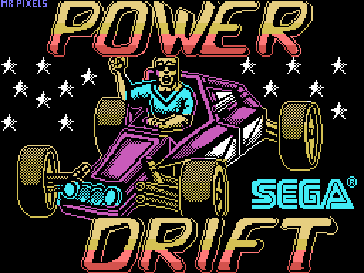
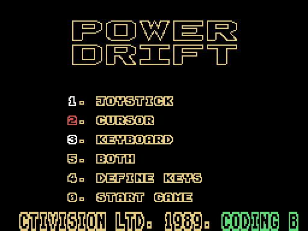
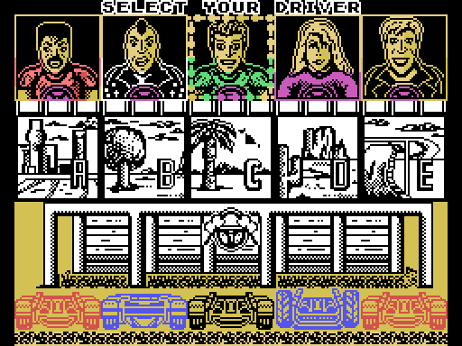
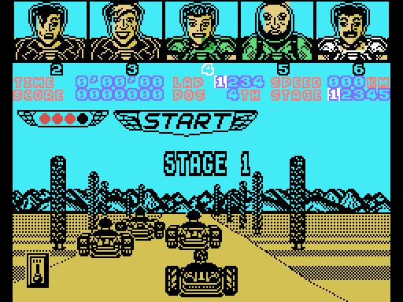
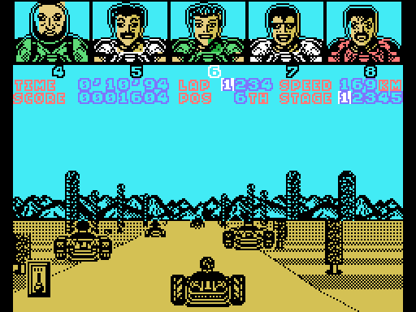
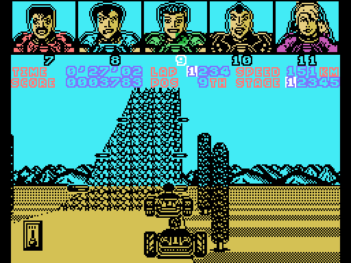
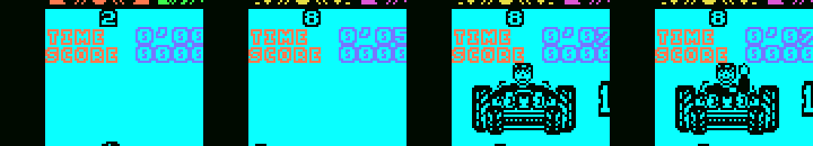

# Power Drift Enhanced (MSX1 + SCC)

[Español](README.md) · **English** · [日本語](README.ja.md)

An enhanced version of the MSX1 *Power Drift* (Activision, 1989; converted by New Frontier) on a 512 KB Konami SCC cartridge. It has Hiroshi Kawaguchi's arcade music arranged for SCC + PSG, runs faster, adds a new engine sound, no longer misses key presses and fixes several bugs.

<p>
  
  
</p>

## Download

[`releases/PowerDrift_SCC_v1.0.rom`](releases/PowerDrift_SCC_v1.0.rom): 512 KB, Konami SCC mapper, detected automatically by openMSX and blueMSX. SHA-1 `db43b55d4891f4e218769e768ded9603c68342c7`.

On real hardware you need a flash cartridge that works as a Konami SCC and has an SCC chip (for example, a MegaFlashROM SCC+). On the One Chip MSX, load it with `mglocm /s`.

## What is new compared with the original

- **Arcade music on SCC + PSG** (5 SCC voices and 3 PSG voices). There is one song for the menu and one for each stage. The stage 4 melody uses an overdriven guitar sound, and stage 3 reuses the stage 1 music.
- **Sound option** in the menu (key 5):
  - MUSIC.
  - ENGINE: the original engine sound, with no music during the race.
  - BOTH: music and engine together. This is the default.
- **New kart engine sound** in BOTH. Its pitch follows the speed, the gear and the throttle. Braking and drifting now also make a tyre squeal.
- **Faster:** the driver's head is drawn with sprites, and repeated work has been removed. On an HB-20P the race goes from 6.77 to about 7.3 frames per second with BOTH (about 7.5 with MUSIC).
- **Real-time race clock:** the clock counts VDP interrupts (50 or 60 Hz), so race times do not depend on how fast the game draws.
- **No more missed key presses:** the game reads the controls only once per frame it draws. Keys are now recorded on every video frame, so a short tap of SPACE (gear change) is no longer lost.
- **Joystick:** the button accelerates and up changes gear.
- **Quicker menus:** the logo spins twice as fast, and the driver faces scroll by sooner.
- **Fixes:** the driver's head on the end-of-stage position screen is drawn correctly again, and the game no longer hangs on that screen.
- **Works with One Chip MSX loaders:** the ROM detects whether it was loaded as Konami SCC, ASCII16 or ASCII8. Without an SCC chip, only the PSG voices play.
- **Pause** with RETURN: the SCC and the PSG go silent, and the song resumes where it stopped.

<p></p>

A detailed change log of every work version, in Spanish, is in [docs/HISTORIAL.md](docs/HISTORIAL.md).

## Controls

In the menu: 1 joystick, 2 cursor keys, 3 keyboard (4 redefines the keys), 5 sound, 0 start.

| In the race | Keyboard (cursor keys) | Joystick |
|---|---|---|
| Accelerate | Up | Button |
| Brake | Down | Down |
| Steer | Left / right | Left / right |
| Change gear (LOW/HIGH) | SPACE | Up |
| Pause | RETURN | RETURN |

The joystick always works, even if you chose the keyboard in the menu. In the original game you accelerated with up on the joystick.

## Building the ROM

Nothing from the original game is included. The disassembly in `desensamblado/` contains the commented code, but the data (graphics, texts, tracks and tables) are left as `DS n,RELLENO` gaps. The build fills these gaps with the bytes from your own tape:

```
python3 construir.py "Power Drift (Side A).cas" "Power Drift (Side B).cas"
```

1. `tools/extrae_originales.py` reads both tape sides. It accepts the English .cas or the Spanish-edition .tsx files. It extracts the game memory, the loading screen and the side B block, and checks their SHA-1. The results go to `originales/`, which git ignores.
2. `rom/build_rom.py` assembles the game twice (RELLENO = 00h and FFh) and fills the gaps with the tape data. It then adds the new code and the music, and writes `rom/PowerDrift_SCC.rom`.
3. `construir.py` compares the result with the ROM in `releases/`.

You need Python 3, plus sjasmplus or pasmo in the PATH. The build was checked with pasmo 0.5.3 from a clean copy of the repository (`git archive`), using both the English tape and the Spanish .tsx files. Both builds give the same ROM as `releases/`.

Folders:

- `desensamblado/`: `juego.asm` (memory 01FDh-FFE4h), `pantalla.asm` (loading screen) and `ladoB.asm` (driver heads). The disassembly was made from scratch and is not based on anyone else's.
- `rom/`: boot and mapper detection (`rom0.asm`), patches and resident code (`residente.asm`), the music player (`musica.asm`) and the songs (`musica/*.mus`).
- `musica_scc/`: how the songs were made, with ChipForge scripts and conversion scripts. Some scripts need the MAME capture and the ChipForge trace, which are not in the repository, so they are included for reference only.

Comments and documentation are in Spanish.

## License and notices

- Tools and build scripts (`construir.py`, `rom/build_rom.py`, `tools/`, `musica_scc/*.py`): [MIT](LICENSE).
- Commented disassembly, ROM sources, music arrangements and documentation: [CC BY-NC-SA 4.0](LICENSE-CC).
- *Power Drift* is © SEGA (1988, arcade). The MSX version is by Activision (1989), converted by New Frontier. The original code, graphics, texts and music belong to their rights holders, and neither license covers them. Neither license covers the original game or the ROM in `releases/`.
- This is a non-profit tribute. No original tapes, disks or dumps are distributed. It will be taken down if any rights holder asks.
- ChipForge belongs to VC-Anvil. It was used as a tool to arrange the music. None of its code is in this repository or in the ROM.

## Credits

- **Power Drift** (arcade): SEGA, 1988. Music by Hiroshi Kawaguchi.
- **ZX Spectrum version**, on which the MSX version is based: John Mullins (code), Clive Paul (graphics) and Dave Lowe (music and sound effects), Software Studios.
- **MSX conversion:** New Frontier (Barcelona), with code by Zydro and music by Mc Alby. Published by Activision (1989).
- **Loading screen:** "Mr Pixels".
- **Power Drift Enhanced:** araubi (direction, testing, and music arrangements with ChipForge). Disassembly, patches and documentation developed with Claude (Anthropic).
