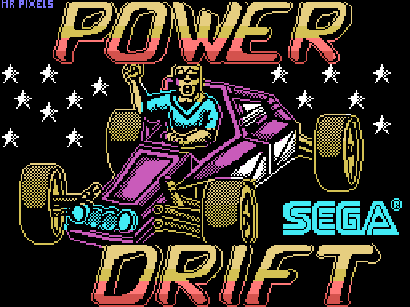
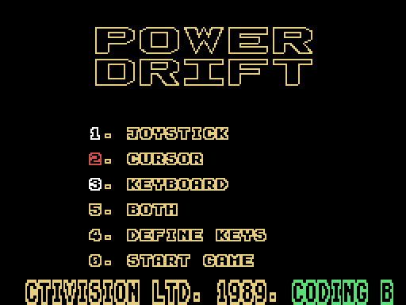
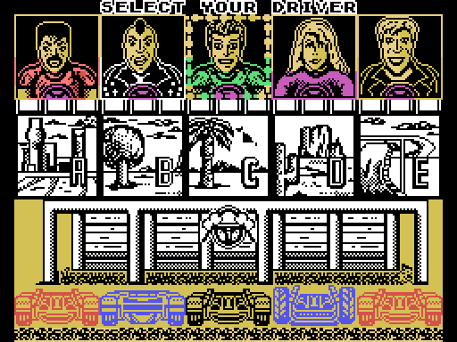
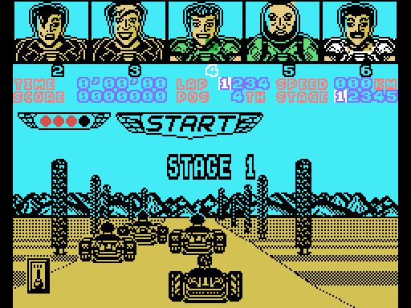
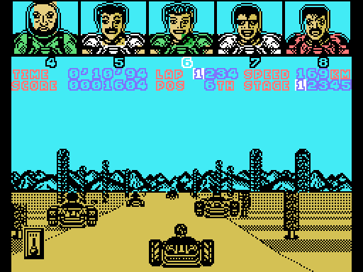
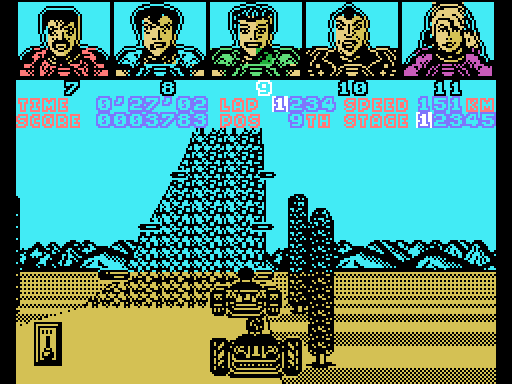
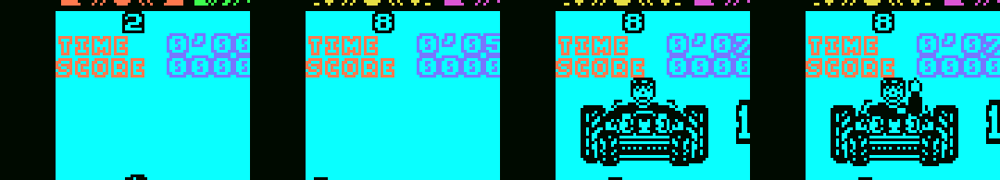

# Power Drift Enhanced (MSX1 + SCC)

[Español](README.md) · [English](README.en.md) · **日本語**

MSX1版『パワードリフト』(Activision、1989年。移植は New Frontier)の改良版です。512KB の コナミ SCC カートリッジ用で、主な変更点は次のとおりです。

- 川口博史氏作曲のアーケード版の音楽を SCC + PSG 用にアレンジ
- 動作の高速化
- 新しいエンジン音
- キー入力の取りこぼしをなくした
- いくつかの不具合を修正

<p>
  
  
</p>

## ダウンロード

[`releases/PowerDrift_SCC_v1.0.rom`](releases/PowerDrift_SCC_v1.0.rom)(512KB、コナミ SCC メガロム。openMSX と blueMSX は自動で判別します)。SHA-1 `db43b55d4891f4e218769e768ded9603c68342c7`。

実機では、SCC チップを搭載し、コナミ SCC として動作するフラッシュカートリッジ(MegaFlashROM SCC+ など)が必要です。One Chip MSX では `mglocm /s` で読み込んでください。

## オリジナルからの変更点

- **アーケードの音楽を SCC + PSG で演奏**(SCC 5音、PSG 3音)。メニュー用に1曲、各ステージに1曲ずつあります。ステージ4のメロディーはディストーションギター風の音色です。ステージ3ではステージ1の曲を使います。
- **サウンド設定**(メニューで 5 キー):
  - MUSIC
  - ENGINE:オリジナルのエンジン音のみ。レース中は音楽なし。
  - BOTH:音楽とエンジン音の両方。初期設定です。
- **新しいカートのエンジン音**(BOTH)。速度、ギア、アクセルに合わせて音の高さが変わります。ブレーキとドリフトのスキール音も追加しました。
- **高速化**:ドライバーの頭をスプライトで描くようにし、重複していた処理を省きました。HB-20P でのレース中の描画は毎秒 6.77 枚から約 7.3 枚(BOTH。MUSIC では約 7.5 枚)になりました。
- **実時間のレースタイム**:VDP 割り込み(50/60Hz)で数えるため、描画速度がタイムに影響しません。
- **キー入力の取りこぼしなし**:ゲームは描画1枚ごとに一度しか入力を読みません。そこで毎フレームのキー入力を記録するようにしたので、スペースキー(ギアチェンジ)を短く押しても取りこぼしません。
- **ジョイスティック**:ボタンでアクセル、上でギアチェンジ。
- **メニューの高速化**:ロゴの回転が2倍速になり、ドライバーの顔の切り替えも速くなりました。
- **不具合修正**:ステージ終了時の順位画面でドライバーの頭が正しく表示されるようになりました。また、この画面で止まる不具合を直しました。
- **One Chip MSX のローダーに対応**:コナミ SCC、ASCII16、ASCII8 のどれで読み込まれたかを ROM が自動で判別します。SCC チップがない場合は PSG の音だけが鳴ります。
- **ポーズ**:RETURN キーで SCC と PSG が止まり、解除すると曲は止めた所から再開します。

<p></p>

各作業版の詳しい変更履歴(スペイン語)は [docs/HISTORIAL.md](docs/HISTORIAL.md) にあります。

## 操作方法

メニュー:1 ジョイスティック、2 カーソルキー、3 キーボード(4 でキー設定)、5 サウンド、0 スタート。

| レース中 | キーボード(カーソル) | ジョイスティック |
|---|---|---|
| アクセル | 上 | ボタン |
| ブレーキ | 下 | 下 |
| ハンドル | 左 / 右 | 左 / 右 |
| ギアチェンジ (LOW/HIGH) | スペース | 上 |
| ポーズ | RETURN | RETURN |

メニューでキーボードを選んでいても、ジョイスティックは常に使えます。オリジナルでは、ジョイスティックの上でアクセルでした。

## ROM のビルド

オリジナルのゲームのデータは一切含まれていません。`desensamblado/` の逆アセンブルにはコメント付きのコードが入っています。データ(グラフィック、テキスト、コース、テーブル)は `DS n,RELLENO` の空き領域になっていて、ビルド時にお手持ちのテープのデータで埋めます。

```
python3 construir.py "Power Drift (Side A).cas" "Power Drift (Side B).cas"
```

1. `tools/extrae_originales.py` がテープの両面を読み込みます。英国版の .cas とスペイン版の .tsx に対応しています。ゲームのメモリ、ローディング画面、B面のデータを取り出して SHA-1 を確認し、`originales/` に保存します。このフォルダは git の対象外です。
2. `rom/build_rom.py` がゲームを2回アセンブルします(RELLENO = 00h と FFh)。そして空き領域をテープのデータで埋め、新しいコードと音楽を加えて `rom/PowerDrift_SCC.rom` を作ります。
3. `construir.py` が結果を `releases/` の ROM と比較します。

ビルドには Python 3 と、PATH 上の sjasmplus または pasmo が必要です。リポジトリのクリーンコピー(`git archive`)から pasmo 0.5.3 でビルドを確認しました。英国版テープでもスペイン版 .tsx でも、`releases/` と同じ ROM ができます。

フォルダ:

- `desensamblado/`:`juego.asm`(メモリ 01FDh-FFE4h)、`pantalla.asm`(ローディング画面)、`ladoB.asm`(ドライバーの頭)。他の人の逆アセンブルは使わず、ゼロから作成しました。
- `rom/`:起動とメガロム判別(`rom0.asm`)、パッチと常駐コード(`residente.asm`)、音楽ドライバー(`musica.asm`)と曲データ(`musica/*.mus`)。
- `musica_scc/`:曲の作成手順(ChipForge のスクリプトと変換スクリプト)。一部のスクリプトは、リポジトリに含まれない MAME のキャプチャと ChipForge のトレースが必要なので、参考用です。

コメントとドキュメントはスペイン語です。

## ライセンスと注意事項

- ツールとビルドスクリプト(`construir.py`、`rom/build_rom.py`、`tools/`、`musica_scc/*.py`):[MIT](LICENSE)。
- コメント付き逆アセンブル、ROM のソース、音楽アレンジ、ドキュメント:[CC BY-NC-SA 4.0](LICENSE-CC)。
- 『パワードリフト』は © SEGA(1988年、アーケード)です。MSX 版は Activision(1989年)の発売で、移植は New Frontier です。オリジナルのコード、グラフィック、テキスト、音楽の権利は各権利者に帰属し、どちらのライセンスの対象にもなりません。オリジナルのゲームと `releases/` の ROM も、どちらのライセンスの対象にもなりません。
- 非営利のトリビュートです。オリジナルのテープ、ディスク、ダンプは配布していません。権利者から要請があれば公開を取り下げます。
- ChipForge は VC-Anvil のものです。音楽のアレンジにツールとして使用しました。そのコードはこのリポジトリにも ROM にも含まれていません。

## クレジット

- **パワードリフト**(アーケード):SEGA、1988年。音楽:川口博史。
- **ZX Spectrum 版**(MSX 版の元):John Mullins(プログラム)、Clive Paul(グラフィック)、Dave Lowe(音楽・効果音)、Software Studios。
- **MSX 移植**:New Frontier(バルセロナ)。プログラム:Zydro、音楽:Mc Alby。発売:Activision(1989年)。
- **ローディング画面**:「Mr Pixels」。
- **Power Drift Enhanced**:araubi(ディレクション、テスト、ChipForge による音楽アレンジ)。逆アセンブル、パッチ、ドキュメントは Claude(Anthropic)と共に開発。
