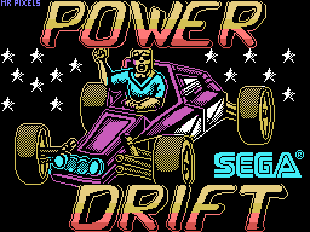
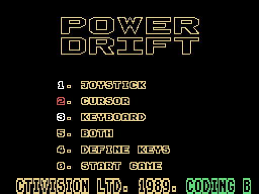
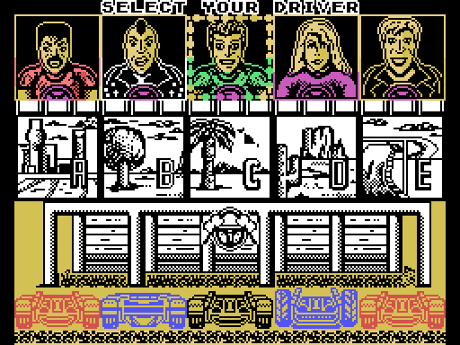
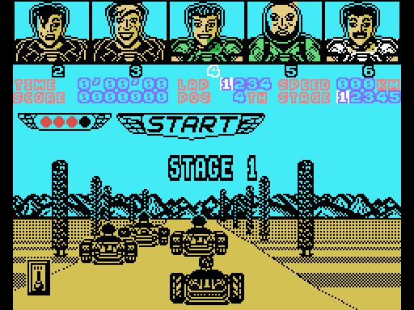
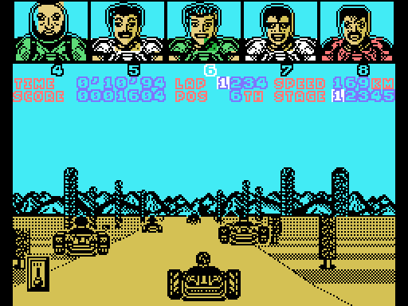
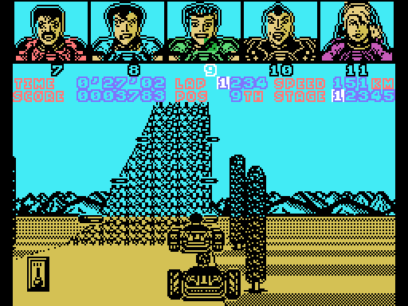
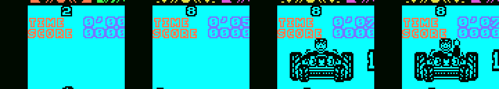

# Power Drift Enhanced (MSX1 + SCC)

**Español** · [English](README.en.md) · [日本語](README.ja.md)

Versión mejorada del *Power Drift* de MSX1 (Activision, 1989; conversión de New Frontier) en un cartucho Konami SCC de 512 KB: la música del arcade de Hiroshi Kawaguchi arreglada para SCC + PSG, más velocidad, sonido del motor nuevo, controles que no pierden pulsaciones y varios arreglos.

<p>
  
  
</p>

## Descarga

[`releases/PowerDrift_SCC_v1.0.rom`](releases/PowerDrift_SCC_v1.0.rom) (512 KB, mapper Konami SCC; openMSX y blueMSX lo detectan solos). SHA-1 `db43b55d4891f4e218769e768ded9603c68342c7`.

En una máquina real hace falta un cartucho flash que haga de Konami SCC con su chip SCC (por ejemplo, una MegaFlashROM SCC+). En el One Chip MSX: `mglocm /s`.

## Qué cambia frente al original

- **Música del arcade en SCC + PSG** (5 voces SCC y 3 del PSG), con una canción para el menú y una por etapa. La melodía de la etapa 4 lleva un sonido de guitarra saturada. La etapa 3 repite la música de la etapa 1.
- **Opción de sonido** en el menú (tecla 5): MUSIC, ENGINE (el motor original, sin música en carrera) o BOTH (música y motor a la vez, opción por defecto).
- **Motor del kart nuevo** en BOTH, que sube y baja con la velocidad, la marcha y el acelerador. Además, chirrido de frenada y de derrape.
- **Más rápido:** la cabeza del piloto va en sprites y se han quitado trabajos repetidos. En un HB-20P la carrera pasa de 6,77 a unas 7,3 imágenes por segundo con BOTH (alrededor de 7,5 con MUSIC).
- **Reloj de la carrera en tiempo real:** cuenta las interrupciones del VDP (50 o 60 Hz), así que el tiempo no depende de lo rápido que dibuje el juego.
- **Teclado sin pulsaciones perdidas:** el juego solo mira los controles una vez por imagen. Ahora las teclas se apuntan en cada cuadro, y un toque corto de ESPACIO (cambio de marcha) ya no se pierde.
- **Joystick:** acelera con el botón y cambia de marcha con arriba.
- **Menús más ágiles:** el logotipo gira el doble de rápido y las caras de los pilotos pasan antes.
- **Arreglos:** la cabeza del piloto vuelve a salir bien en el cartel del puesto al acabar la etapa, y el juego ya no se cuelga ahí.
- **Compatible con los cargadores del One Chip MSX:** la ROM averigua si la han cargado como Konami SCC, ASCII16 o ASCII8. Sin chip SCC solo suenan las voces del PSG.
- **Pausa** con RETURN: calla el SCC y el PSG y la canción sigue donde estaba.

<p></p>

El detalle de cada versión de trabajo está en [docs/HISTORIAL.md](docs/HISTORIAL.md).

## Controles

En el menú: 1 joystick, 2 cursores, 3 teclado (con 4 se definen las teclas), 5 sonido y 0 empezar.

| En carrera | Teclado (cursores) | Joystick |
|---|---|---|
| Acelerar | Arriba | Botón |
| Frenar | Abajo | Abajo |
| Girar | Izquierda / derecha | Izquierda / derecha |
| Cambiar de marcha (LOW/HIGH) | ESPACIO | Arriba |
| Pausa | RETURN | RETURN |

El joystick funciona siempre, aunque en el menú se haya elegido teclado. Con joystick acelera el botón y arriba cambia de marcha; en el original se aceleraba con arriba.

## Construir la ROM

No se incluye nada del juego original. El desensamblado (`desensamblado/`) lleva el código comentado, pero los datos (gráficos, textos, circuitos y tablas) van como huecos `DS n,RELLENO`. Se rellenan con los bytes de tu propia cinta:

```
python3 construir.py "Power Drift (Side A).cas" "Power Drift (Side B).cas"
```

1. `tools/extrae_originales.py` saca de las dos caras (.cas inglés o .tsx de la edición española) la memoria del juego, la pantalla de carga y el bloque de la cara B, y comprueba su SHA-1. Los deja en `originales/`, que git no sube.
2. `rom/build_rom.py` ensambla el juego dos veces (RELLENO = 00h y FFh), pone los datos de la cinta en los huecos, añade el código nuevo y la música y monta la ROM en `rom/PowerDrift_SCC.rom`.
3. `construir.py` compara el resultado con la ROM de `releases/`.

Hacen falta Python 3 y sjasmplus o pasmo en el PATH. Comprobado con pasmo 0.5.3 desde una copia limpia del repositorio (`git archive`), con la cinta inglesa y con los .tsx españoles: sale la misma ROM que la de `releases/`.

Carpetas:

- `desensamblado/`: `juego.asm` (memoria 01FDh-FFE4h), `pantalla.asm` (pantalla de carga) y `ladoB.asm` (cabezas de los pilotos). Desensamblado hecho desde cero; no parte de ningún desensamblado ajeno.
- `rom/`: arranque y detección del mapper (`rom0.asm`), parches y código residente (`residente.asm`), lector de la música (`musica.asm`) y canciones (`musica/*.mus`).
- `musica_scc/`: cómo se hicieron las canciones (guiones de ChipForge y scripts de conversión). Algunos scripts necesitan la captura de MAME y la traza de ChipForge, que no van en el repositorio. Sirven de referencia.

## Licencia y avisos

- Herramientas y scripts de montaje (`construir.py`, `rom/build_rom.py`, `tools/`, `musica_scc/*.py`): [MIT](LICENSE).
- Desensamblado comentado, fuentes de la ROM, arreglos musicales y documentación: [CC BY-NC-SA 4.0](LICENSE-CC).
- *Power Drift* es © SEGA (1988, arcade). La versión de MSX es de Activision (1989), con conversión de New Frontier. El código, los gráficos, los textos y la música originales son de sus titulares, y ninguna de las dos licencias los cubre. Ni el juego original ni la ROM de `releases/` están cubiertos por ellas.
- Es un homenaje sin ánimo de lucro: no se distribuyen cintas, discos ni volcados originales. Si algún titular de derechos lo pide, se retira.
- ChipForge es de VC-Anvil. Se ha usado como herramienta para arreglar la música, y su código no está en este repositorio ni en la ROM.

## Créditos

- **Power Drift** (arcade): SEGA, 1988. Música de Hiroshi Kawaguchi.
- **Versión de Spectrum**, base de la de MSX: John Mullins (programa), Clive Paul (gráficos) y Dave Lowe (música y efectos), Software Studios.
- **Conversión a MSX:** New Frontier (Barcelona); programa de Zydro y música de Mc Alby. Editado por Activision (1989).
- **Pantalla de carga:** «Mr Pixels».
- **Power Drift Enhanced:** araubi (dirección, pruebas y arreglos musicales con ChipForge). Desensamblado, parches y documentación desarrollados con Claude (Anthropic).
